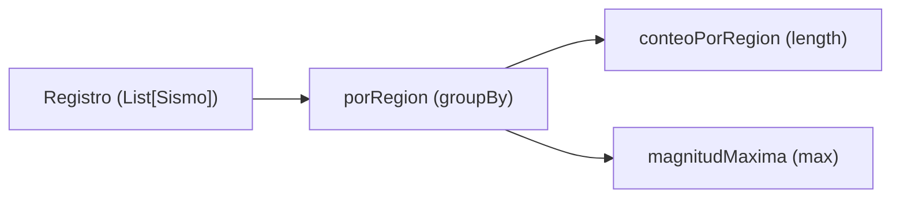
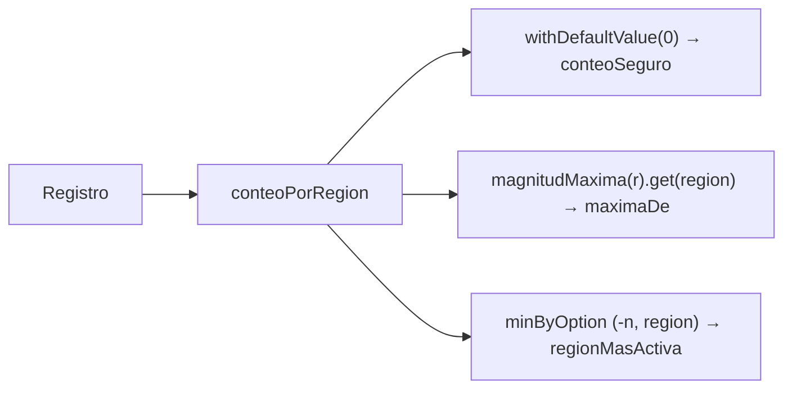
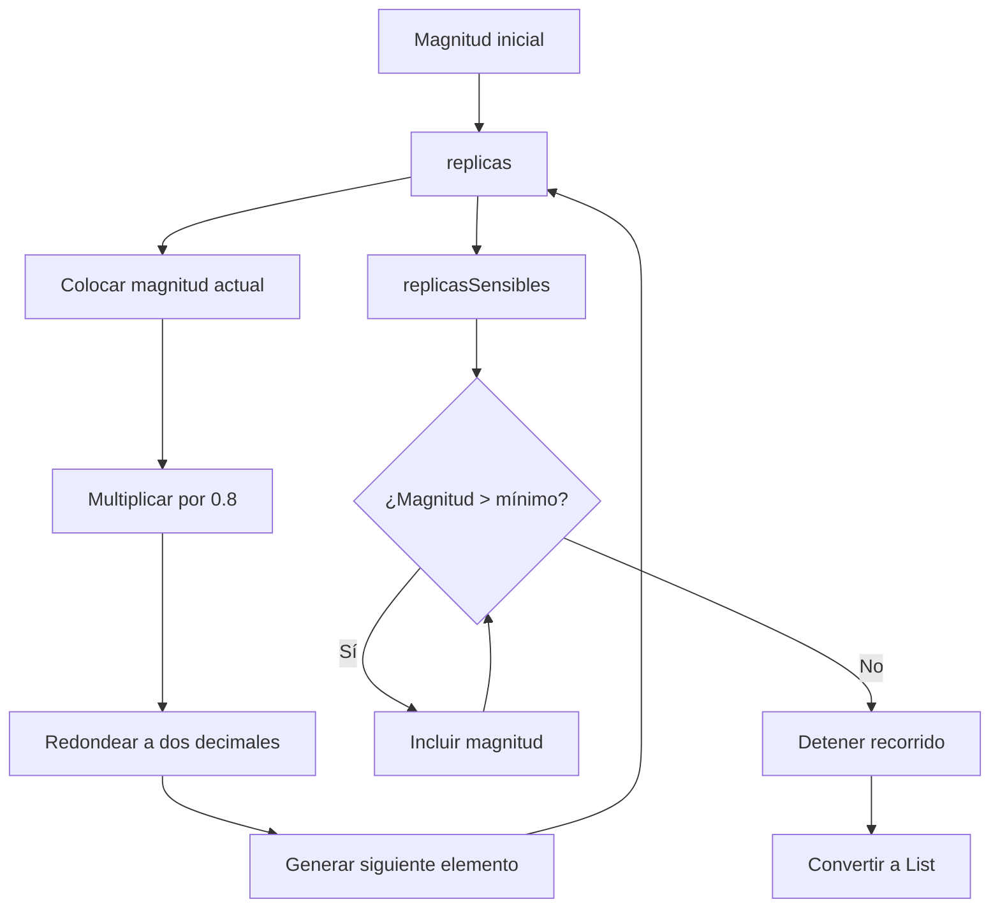
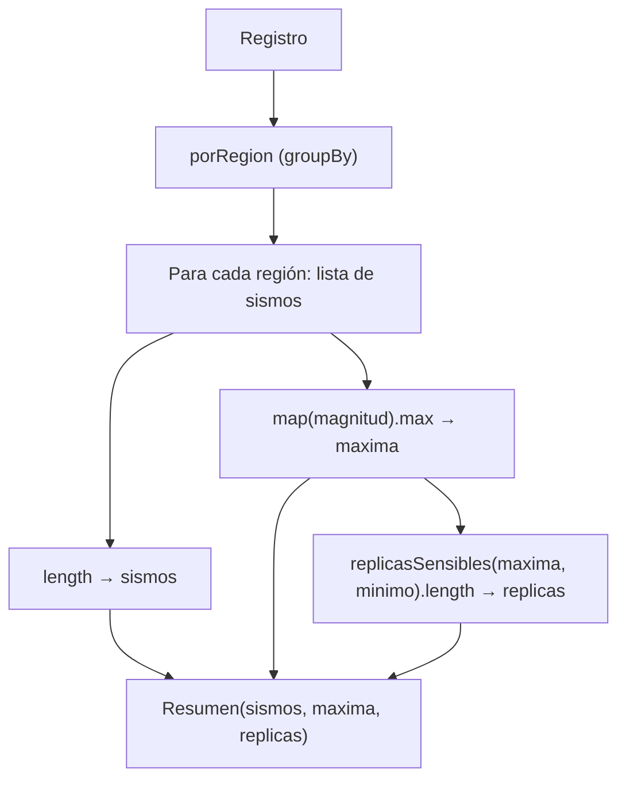

# Informe de proceso

Taller 3: Programación funcional y concurrente. Consultas sobre un registro sísmico.

Este informe explica cómo se ejecuta cada función, en qué operaciones se traduce
cada expresión `for` usada y por qué la secuencia perezosa del punto 4 no agota
la memoria aunque sea infinita.

## Punto 1: consultas con expresiones `for`
 
### Idea general
 
Una expresión `for ... yield` recorre una colección y arma otra nueva. El
compilador la traduce a llamadas de `withFilter`, `map` y `flatMap`:
 
| En el `for` | Se traduce a |
|---|---|
| `x <- lista` (único generador) con `yield e` | `lista.map(x => e)` |
| `if condicion` | `withFilter(x => condicion)` |
| dos generadores `x <- a; y <- b` con `yield e` | `a.flatMap(x => b.map(y => e))` |
| patrón `(a, i) <- lista` | `lista.withFilter { case (a, i) => true; case _ => false }`, que comprueba que cada elemento encaje en el patrón, y luego sigue la traducción normal |
 
### `fuertes(r, umbral)`
 
```scala
for {
  s <- r
  if s.magnitud > umbral
} yield s.region
```
 
Se traduce a:
 
```scala
r.withFilter(s => s.magnitud > umbral).map(s => s.region)
```
 
Traza con `fuertes(registro, 5.0)`:
 
1. Se recorren los siete sismos en orden.
2. Pasan el filtro (magnitud > 5.0): #2 (5.1), #4 (6.0) y #6 (5.3).
3. `map` toma la región de cada uno: `List("Santander", "Choco", "Valle")`.
No se quitan repetidos y se conserva el orden, como pide el enunciado.
 
### `enRegion(r, region)`
 
```scala
for {
  s <- r
  if s.region == region
} yield s.magnitud
```
 
Se traduce a `r.withFilter(s => s.region == region).map(s => s.magnitud)`.
 
Traza con `enRegion(registro, "Valle")`: pasan los sismos #1, #3 y #6, y sus
magnitudes son `List(4.2, 3.8, 5.3)`. Si la región no existe, ningún sismo pasa
el filtro y el resultado es `List()`.
 
### `paresCercanos(r, dif)`
 
Esta función usa dos `for` y una lista auxiliar:
 
```scala
val regiones = r.map(_.region).distinct.zipWithIndex
```
 
`distinct` deja cada región una sola vez, en el orden en que aparece, y
`zipWithIndex` le pone a cada una su posición. Con el registro de ejemplo:
`List(("Valle", 0), ("Santander", 1), ("Choco", 2))`.
 
**`for` interno (función `hayCercanos`)**
 
```scala
(for {
  x <- enRegion(r, a)
  y <- enRegion(r, b)
  if Math.abs(x - y) <= dif
} yield 1).nonEmpty
```
 
Se traduce a:
 
```scala
enRegion(r, a).flatMap(x =>
  enRegion(r, b).withFilter(y => Math.abs(x - y) <= dif).map(y => 1)
).nonEmpty
```
 
Prueba todas las combinaciones de una magnitud de `a` con una de `b`. Si alguna
difiere a lo sumo `dif`, la lista tiene un elemento y `nonEmpty` es `true`.
 
**`for` externo**
 
```scala
for {
  (a, i) <- regiones
  (b, j) <- regiones
  if i < j
  if hayCercanos(a, b)
} yield (a, b)
```
 
Se traduce a:
 
```scala
regiones
  .withFilter { case (a, i) => true; case _ => false }
  .flatMap { case (a, i) =>
    regiones
      .withFilter { case (b, j) => true; case _ => false }
      .withFilter { case (b, j) => i < j }
      .withFilter { case (b, j) => hayCercanos(a, b) }
      .map { case (b, j) => (a, b) }
  }
```
 
Esta es la traducción que hace el compilador de Scala 2.13: cada patrón
`(a, i)` y `(b, j)` agrega un `withFilter` que comprueba que el elemento encaje
en el patrón (siempre encaja, porque son parejas), y cada `if` del `for` se
vuelve su propio `withFilter`, en el mismo orden en que se escribieron.

La condición `i < j` es la que evita repeticiones: de cada pareja de regiones
solo se considera la que tiene primero la que apareció antes. Así, si salió
`("Valle", "Choco")` no puede salir `("Choco", "Valle")`, y una región nunca se
empareja consigo misma (porque `i < i` es falso).
 
Traza con `paresCercanos(registro, 0.6)`:
 
| Pareja (i < j) | Menor diferencia de magnitudes | ¿≤ 0.6? |
|---|---|---|
| Valle – Santander | 0.2 (5.3 y 5.1) | sí |
| Valle – Choco | 0.7 (5.3 y 6.0) | no |
| Santander – Choco | 0.9 (5.1 y 6.0) | no |
 
Resultado: `List(("Valle", "Santander"))`.
 
## Punto 2: agrupar con mapas
 
### `porRegion(r)`
 
```scala
r.groupBy(s => s.region)
```
 
`groupBy` crea un mapa cuya llave es la región y cuyo valor es la lista de
sismos de esa región, en el mismo orden en que estaban en el registro. Con el
ejemplo:
 
```text
"Valle"     -> List(sismo #1, #3, #6)
"Santander" -> List(sismo #2, #5)
"Choco"     -> List(sismo #4, #7)
```
 
Una región que no está en el registro no aparece como llave.
 
### `conteoPorRegion(r)`
 
```scala
porRegion(r).map { case (region, sismos) => (region, sismos.length) }
```
 
Recorre el mapa y reemplaza cada lista por su tamaño:
`Map("Valle" -> 3, "Santander" -> 2, "Choco" -> 2)`. Con el registro vacío,
`porRegion` da `Map()` y el resultado también es `Map()`.
 
### `magnitudMaxima(r)`
 
```scala
porRegion(r).map { case (region, sismos) => (region, sismos.map(s => s.magnitud).max) }
```
 
Para cada región se sacan las magnitudes de sus sismos y se toma la mayor. El
`max` nunca falla porque cada llave de `porRegion` tiene al menos un sismo.
Resultado con el ejemplo: `Map("Valle" -> 5.3, "Santander" -> 5.1, "Choco" -> 6.0)`.
 

 


## Punto 3: consultas seguras

Un `Map` de Scala lanza `NoSuchElementException` si se le pide una llave que no
tiene. Las tres funciones de este punto evitan esa excepción de dos maneras
distintas: con un **valor por defecto** (`conteoSeguro`) y con el tipo `Option`
(`maximaDe` y `regionMasActiva`). Ninguna usa `for`: se apoyan en los mapas del
punto 2.

### `conteoSeguro(r)`

```scala
conteoPorRegion(r).withDefaultValue(0)
```

`withDefaultValue(0)` envuelve el mapa en otro que responde `0` cuando la llave
no está. No agrega llaves: solo cambia lo que devuelve `apply` cuando falta una.

Traza con `conteoSeguro(registro)("Amazonas")`:

1. `conteoPorRegion(registro)` da `Map("Valle" -> 3, "Santander" -> 2, "Choco" -> 2)`.
2. `withDefaultValue(0)` devuelve el mismo mapa con el valor por defecto 0.
3. `("Amazonas")` busca la llave, no la encuentra y devuelve `0`.
4. Con `("Valle")` la llave sí existe y devuelve `3`.

### `maximaDe(r, region)`

```scala
magnitudMaxima(r).get(region)
```

`get` es la versión segura de `apply`: devuelve `Some(valor)` si la llave existe
y `None` si no. Como `magnitudMaxima` solo tiene llaves de regiones con al menos
un sismo, `None` significa exactamente "no hay registros de esa región".

Traza: con `"Choco"`, `magnitudMaxima(registro)` es
`Map("Valle" -> 5.3, "Santander" -> 5.1, "Choco" -> 6.0)` y `get("Choco")` da
`Some(6.0)`. Con `"Amazonas"` la llave no está y da `None`.

### `regionMasActiva(r)`

```scala
conteoPorRegion(r)
  .minByOption { case (region, n) => (-n, region) }
  .map { case (region, _) => region }
```

Se necesita la región con **más** sismos y, si hay empate, la primera en orden
alfabético. Las dos reglas se resuelven con un solo criterio: `minByOption`
elige el elemento cuya clave `(-n, region)` es la menor. Las claves se comparan
en orden lexicográfico:

1. Primero se compara `-n`. El menor `-n` es el mayor conteo `n`.
2. Si los conteos empatan, se compara `region`, y gana el menor nombre en orden
   alfabético.

`minByOption` devuelve `Option`: `None` si el mapa está vacío (registro vacío) y
`Some(elemento)` si no. Por eso no hace falta preguntar `isEmpty` ni usar `head`.

Traza con `regionMasActiva(registro)`:

| Región | Conteo `n` | Clave `(-n, region)` |
|---|---|---|
| Valle | 3 | `(-3, "Valle")` |
| Santander | 2 | `(-2, "Santander")` |
| Choco | 2 | `(-2, "Choco")` |

La clave menor es `(-3, "Valle")`, así que el resultado es `Some("Valle")`.

Traza de un empate, `Zulia` y `Arauca` con un sismo cada una: las claves son
`(-1, "Zulia")` y `(-1, "Arauca")`. Los primeros componentes son iguales, y
`"Arauca" < "Zulia"`, así que gana `Some("Arauca")`. Con `List()` el mapa está
vacío y el resultado es `None`.



## Punto 4: generación de réplicas con evaluación perezosa

### Idea general

En este punto se utilizan dos funciones para generar una secuencia de magnitudes sísmicas cada vez menores.

La primera función, `replicas`, genera una secuencia potencialmente infinita. Cada nuevo valor corresponde al 80% del anterior, redondeado a dos decimales.

La segunda función, `replicasSensibles`, utiliza esa secuencia y conserva únicamente los valores que superan un mínimo indicado.

Para implementar este comportamiento se utiliza `LazyList`, una colección de Scala que permite calcular sus elementos solamente cuando son necesarios.

### `redondear(x)`

```scala
def redondear(x: Double): Double =
  Math.round(x * 100.0) / 100.0
```

Esta función redondea un número a dos decimales.

Primero multiplica el valor por 100, después utiliza `Math.round` para redondearlo al entero más cercano y finalmente divide entre 100.

Por ejemplo:

```text
redondear(4.096) = 4.10
redondear(2.567) = 2.57
```

Se utiliza para evitar que las magnitudes de las réplicas tengan más de dos decimales.

### `replicas(magnitud)`

```scala
def replicas(magnitud: Double): LazyList[Double] =
  magnitud #:: replicas(redondear(magnitud * 0.8))
```

Esta función genera una secuencia de magnitudes a partir del valor recibido.

El operador `#::` permite construir una `LazyList` colocando primero el valor actual y después otra secuencia que se calcula de manera perezosa.

El procedimiento es:

1. Se recibe la magnitud inicial.
2. Se coloca esa magnitud como primer elemento.
3. Se multiplica por 0.8 y se redondea a dos decimales.
4. Se llama nuevamente a `replicas` con el resultado obtenido.
5. El proceso continúa generando nuevos elementos cuando se solicitan.

Traza con `replicas(5.0)`:

| Iteración | Operación | Resultado |
|---|---|---|
| 0 | Magnitud inicial | 5.0 |
| 1 | 5.0 × 0.8 | 4.0 |
| 2 | 4.0 × 0.8 | 3.2 |
| 3 | 3.2 × 0.8 | 2.56 |
| 4 | 2.56 × 0.8 | 2.05 |

Por tanto:

```scala
replicas(5.0).take(4).toList
```

Devuelve:

```scala
List(5.0, 4.0, 3.2, 2.56)
```

**Evaluación perezosa:**

La secuencia no se construye completamente desde el principio. Solamente se calculan los elementos que se necesitan.

Por ejemplo, `take(4)` solicita los primeros cuatro elementos y no necesita recorrer el resto de la secuencia infinita.

### `replicasSensibles(magnitud, minimo)`

```scala
def replicasSensibles(magnitud: Double, minimo: Double): List[Double] =
  replicas(magnitud).takeWhile(_ > minimo).toList
```

Esta función utiliza la secuencia generada por `replicas` y selecciona los valores que superan estrictamente el mínimo.

Se utilizan dos operaciones:

- `takeWhile(_ > minimo)`: conserva los elementos consecutivos que cumplen la condición. Cuando encuentra el primero que no la cumple, detiene el recorrido.
- `toList`: convierte los elementos seleccionados en una lista normal.

Traza con `replicasSensibles(5.0, 3.0)`:

| Magnitud | ¿Supera el mínimo de 3.0? | Acción |
|---|---|---|
| 5.0 | Sí | Se incluye |
| 4.0 | Sí | Se incluye |
| 3.2 | Sí | Se incluye |
| 2.56 | No | Se detiene |

Resultado:

```scala
List(5.0, 4.0, 3.2)
```

Si la magnitud inicial no supera el mínimo, el resultado es `List()` porque `takeWhile` no encuentra ningún elemento que cumpla la condición.

### Flujo de funcionamiento



### Pruebas propias del punto 4

Se agregaron siete pruebas unitarias para comprobar diferentes comportamientos:

1. **Secuencia correcta:** verifica que las magnitudes se calculen correctamente a partir de la magnitud inicial.
2. **Magnitud inicial:** comprueba que el primer elemento conserve exactamente el valor recibido.
3. **Evaluación perezosa:** solicita 150 elementos de la secuencia y comprueba que se puedan obtener sin recorrerla completamente.
4. **Detención por mínimo:** verifica que `replicasSensibles` se detenga cuando una magnitud deja de superar el mínimo.
5. **Exclusión del mínimo:** comprueba que los valores iguales al mínimo no sean incluidos.
6. **Redondeo:** verifica que las nuevas magnitudes se redondeen a dos decimales.
7. **Lista vacía:** comprueba que se devuelva una lista vacía cuando la magnitud inicial no supera el mínimo.


## Punto 5: informe combinado

### `informe(r, minimo)`

```scala
porRegion(r).map { case (region, sismos) =>
  val maxima = sismos.map(s => s.magnitud).max
  (region, Resumen(sismos.length, maxima, replicasSensibles(maxima, minimo).length))
}
```

La función no recorre el registro a mano: parte del mapa `porRegion` (punto 2) y
transforma cada pareja `(región, lista de sismos)` en una pareja
`(región, Resumen)`. Para cada región:

1. `sismos.length` es el número de sismos (`sismos` del `Resumen`).
2. `sismos.map(s => s.magnitud).max` es la magnitud del sismo más fuerte
   (`maxima`). El `max` no falla porque cada llave de `porRegion` tiene al menos
   un sismo.
3. `replicasSensibles(maxima, minimo)` (punto 4) es la lista de réplicas que
   superan el mínimo, y su `length` es el número de réplicas esperadas
   (`replicas`).

Traza con `informe(registro, 3.0)`:

| Región | Sismos | Máxima | Réplicas desde la máxima (> 3.0) | Cuántas |
|---|---|---|---|---|
| Valle | 3 | 5.3 | 5.3, 4.24, 3.39 (la siguiente, 2.71, no supera 3.0) | 3 |
| Santander | 2 | 5.1 | 5.1, 4.08, 3.26 (la siguiente, 2.61, no supera 3.0) | 3 |
| Choco | 2 | 6.0 | 6.0, 4.8, 3.84, 3.07 (la siguiente, 2.46, no supera 3.0) | 4 |

Resultado: `Map("Valle" -> Resumen(3, 5.3, 3), "Santander" -> Resumen(2, 5.1, 3), "Choco" -> Resumen(2, 6.0, 4))`.
Con `List()`, `porRegion` es `Map()` y `Map().map(...)` es `Map()`.

Las réplicas se calculan sobre el sismo más fuerte, no sobre el primero de la
región: en una región cuyo primer sismo es de 4.0 y el más fuerte es de 7.0, se
usa 7.0.



## Por qué la secuencia perezosa no agota la memoria

`replicas(magnitud)` se define como `magnitud #:: replicas(redondear(magnitud * 0.8))`.
El operador `#::` recibe su cola **por nombre**: no la evalúa al construir la
secuencia, sino que guarda una receta (un *thunk*) para calcularla cuando alguien
la pida. Una `LazyList` es entonces una cadena de celdas, cada una con su valor
ya calculado y una receta pendiente para la siguiente.

Traza de `replicas(5.0).take(4).toList`:

| Paso | Qué ocurre | Celdas calculadas |
|---|---|---|
| Se llama `replicas(5.0)` | Se calcula `5.0`; la cola queda como receta | 1 |
| `take(4)` | Pide 4 elementos; no calcula ninguno más por sí mismo | 1 |
| `toList` pide el 2.º | Se ejecuta la receta: `redondear(5.0 * 0.8)` = `4.0` | 2 |
| `toList` pide el 3.º | `redondear(4.0 * 0.8)` = `3.2` | 3 |
| `toList` pide el 4.º | `redondear(3.2 * 0.8)` = `2.56` | 4 |
| Se llega a 4 elementos | `take(4)` corta; la receta del 5.º **nunca se ejecuta** | 4 |

La memoria que usa la secuencia es proporcional a las celdas que se **forzaron**,
no a su longitud teórica, que es infinita. Por eso `take(4)` usa memoria para 4
elementos, y `replicasSensibles(5.0, 3.0)` usa memoria para 4: los tres que
superan el mínimo y el primero que no, que es el que hace parar a `takeWhile`.
Cada celda se calcula una sola vez, porque la `LazyList` guarda su resultado.

Lo que sí agotaría la memoria (o no terminaría) es materializar la secuencia
completa: `replicas(5.0).toList`, `.length` o `.sum` recorren hasta el final de
una secuencia que no lo tiene. Por eso en el código solo se usa `take` y
`takeWhile` antes de `toList`.

Una consecuencia de que cada valor se redondea a dos decimales es que la
secuencia se estanca en 0.02 (o 0.01) y no baja de ahí: `redondear(0.02 * 0.8)` es
`0.02`. Entonces `replicasSensibles` termina siempre que `minimo >= 0.02`, pero
con un mínimo menor, como `0.0`, `takeWhile(_ > minimo)` nunca encuentra un
elemento que lo detenga y el programa no termina.
