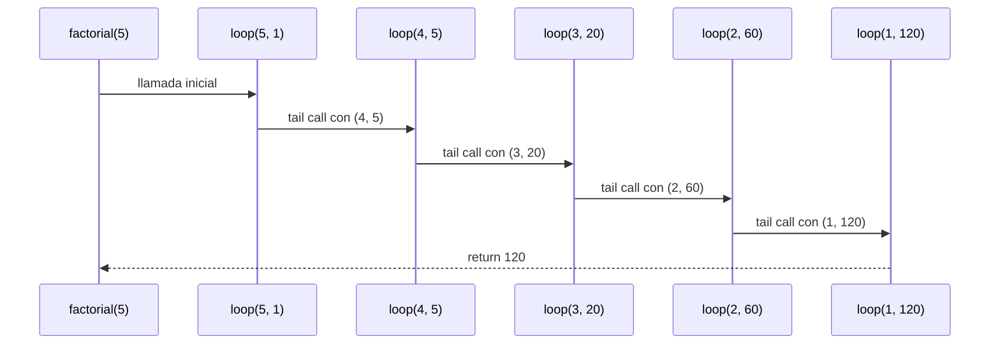
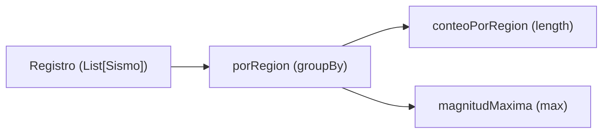
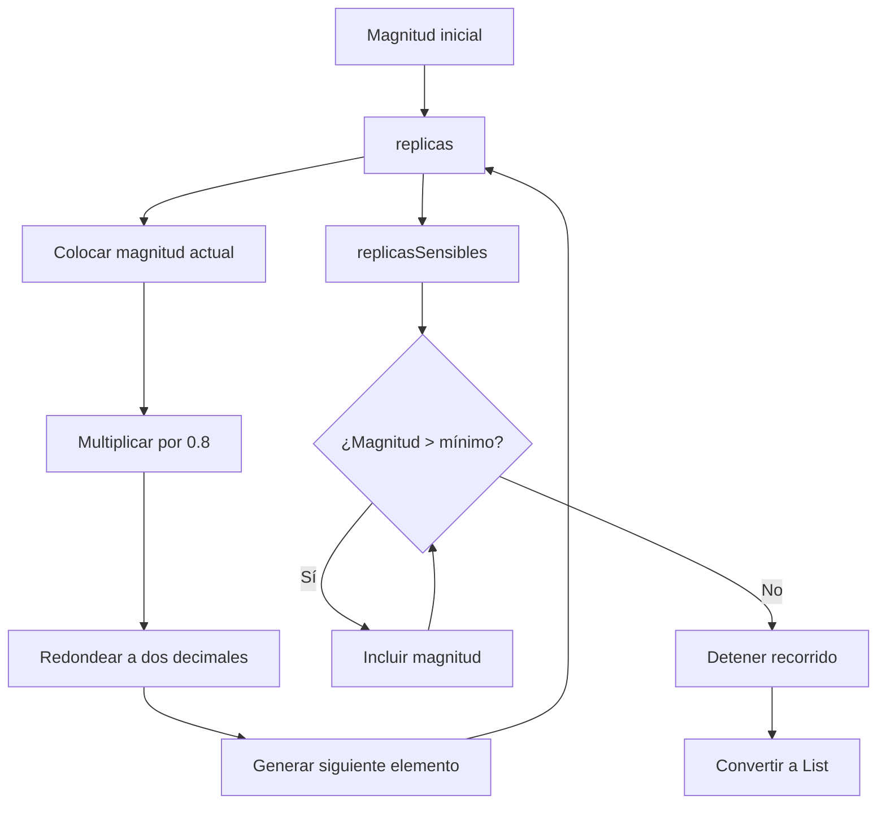

# Algoritmo Factorial con Recursión de Cola

## Definición del Algoritmo

```Scala
def factorial(n: Int): BigInt = {
  @annotation.tailrec
  def loop(x: Int, acumulador: BigInt): BigInt = {
    if (x <= 1) acumulador
    else loop(x - 1, acumulador * x)
  }
  loop(n, 1)
}
```

* La función `factorial` calcula el factorial de un número `n` utilizando **recursión de cola**.
* La función interna `loop` es la que hace la recursión:

  * Recibe dos parámetros:

    * `x`: el valor actual decreciente hasta llegar a 1.
    * `acumulador`: donde se guarda el resultado parcial en cada paso.
* El decorador `@annotation.tailrec` obliga a que la función sea optimizada como recursión de cola, es decir, **no se acumulan llamados en la pila**.

## Explicación paso a paso

### Caso base

```Scala
if (x <= 1) acumulador
```

Cuando `x` llega a `1`, la función retorna directamente el valor acumulado, evitando más llamadas.

### Caso recursivo

```Scala
loop(x - 1, acumulador * x)
```

En cada llamada:

* Se reduce el valor de `x` en 1.
* Se multiplica el acumulador por `x` y se pasa a la siguiente iteración.
* Como es recursión de cola, la llamada recursiva es la **última instrucción** en ejecutarse, lo que permite a Scala optimizar la pila.

---

## Llamados de pila en recursión de cola

Ejemplo:

```Scala
factorial(5)
```

### Paso 1: Llamada inicial

```Scala
loop(5, 1)
```

### Paso 2: Primera iteración

```Scala
loop(4, 5)   // acumulador = 1 * 5
```

### Paso 3: Segunda iteración

```Scala
loop(3, 20)  // acumulador = 5 * 4
```

### Paso 4: Tercera iteración

```Scala
loop(2, 60)  // acumulador = 20 * 3
```

### Paso 5: Cuarta iteración

```Scala
loop(1, 120) // acumulador = 60 * 2
```

### Paso 6: Caso base

```Scala
return 120
```

---

## Diferencia con recursión normal

* En **recursión normal** cada llamada queda en la pila esperando a que termine la siguiente, lo que puede causar desbordamiento si `n` es muy grande.
* En **recursión de cola**, el compilador transforma el proceso en un **bucle optimizado**, por lo que no se guarda cada llamada en la pila y el algoritmo puede ejecutarse para valores muy grandes sin problema.

---

## Ejemplo de uso

```Scala
val resultado = factorial(5)
println(resultado)  // 120
```

El resultado de `factorial(5)` es `120`.


## Diagrama de llamados de pila con recursión de cola




## Punto 1: consultas con expresiones `for`
 
### Idea general
 
Una expresión `for ... yield` recorre una colección y arma otra nueva. El
compilador la traduce a llamadas de `withFilter`, `map` y `flatMap`:
 
| En el `for` | Se traduce a |
|---|---|
| `x <- lista` (único generador) con `yield e` | `lista.map(x => e)` |
| `if condicion` | `withFilter(x => condicion)` |
| dos generadores `x <- a; y <- b` con `yield e` | `a.flatMap(x => b.map(y => e))` |
 
### `fuertes(r, umbral)`
 
```scala
for {
  s <- r
  if s.magnitud > umbral
} yield s.region
```
 
Se traduce a:
 
```scala
r.withFilter(s => s.magnitud > umbral).map(s => s.region)
```
 
Traza con `fuertes(registro, 5.0)`:
 
1. Se recorren los siete sismos en orden.
2. Pasan el filtro (magnitud > 5.0): #2 (5.1), #4 (6.0) y #6 (5.3).
3. `map` toma la región de cada uno: `List("Santander", "Choco", "Valle")`.
No se quitan repetidos y se conserva el orden, como pide el enunciado.
 
### `enRegion(r, region)`
 
```scala
for {
  s <- r
  if s.region == region
} yield s.magnitud
```
 
Se traduce a `r.withFilter(s => s.region == region).map(s => s.magnitud)`.
 
Traza con `enRegion(registro, "Valle")`: pasan los sismos #1, #3 y #6, y sus
magnitudes son `List(4.2, 3.8, 5.3)`. Si la región no existe, ningún sismo pasa
el filtro y el resultado es `List()`.
 
### `paresCercanos(r, dif)`
 
Esta función usa dos `for` y una lista auxiliar:
 
```scala
val regiones = r.map(_.region).distinct.zipWithIndex
```
 
`distinct` deja cada región una sola vez, en el orden en que aparece, y
`zipWithIndex` le pone a cada una su posición. Con el registro de ejemplo:
`List(("Valle", 0), ("Santander", 1), ("Choco", 2))`.
 
**`for` interno (función `hayCercanos`)**
 
```scala
(for {
  x <- enRegion(r, a)
  y <- enRegion(r, b)
  if Math.abs(x - y) <= dif
} yield 1).nonEmpty
```
 
Se traduce a:
 
```scala
enRegion(r, a).flatMap(x =>
  enRegion(r, b).withFilter(y => Math.abs(x - y) <= dif).map(y => 1)
).nonEmpty
```
 
Prueba todas las combinaciones de una magnitud de `a` con una de `b`. Si alguna
difiere a lo sumo `dif`, la lista tiene un elemento y `nonEmpty` es `true`.
 
**`for` externo**
 
```scala
for {
  (a, i) <- regiones
  (b, j) <- regiones
  if i < j
  if hayCercanos(a, b)
} yield (a, b)
```
 
Se traduce a:
 
```scala
regiones.flatMap { case (a, i) =>
  regiones.withFilter { case (b, j) => i < j && hayCercanos(a, b) }
          .map { case (b, j) => (a, b) }
}
```
 
La condición `i < j` es la que evita repeticiones: de cada pareja de regiones
solo se considera la que tiene primero la que apareció antes. Así, si salió
`("Valle", "Choco")` no puede salir `("Choco", "Valle")`, y una región nunca se
empareja consigo misma (porque `i < i` es falso).
 
Traza con `paresCercanos(registro, 0.6)`:
 
| Pareja (i < j) | Menor diferencia de magnitudes | ¿≤ 0.6? |
|---|---|---|
| Valle – Santander | 0.2 (5.3 y 5.1) | sí |
| Valle – Choco | 0.7 (5.3 y 6.0) | no |
| Santander – Choco | 0.9 (5.1 y 6.0) | no |
 
Resultado: `List(("Valle", "Santander"))`.
 
## Punto 2: agrupar con mapas
 
### `porRegion(r)`
 
```scala
r.groupBy(s => s.region)
```
 
`groupBy` crea un mapa cuya llave es la región y cuyo valor es la lista de
sismos de esa región, en el mismo orden en que estaban en el registro. Con el
ejemplo:
 
```text
"Valle"     -> List(sismo #1, #3, #6)
"Santander" -> List(sismo #2, #5)
"Choco"     -> List(sismo #4, #7)
```
 
Una región que no está en el registro no aparece como llave.
 
### `conteoPorRegion(r)`
 
```scala
porRegion(r).map { case (region, sismos) => (region, sismos.length) }
```
 
Recorre el mapa y reemplaza cada lista por su tamaño:
`Map("Valle" -> 3, "Santander" -> 2, "Choco" -> 2)`. Con el registro vacío,
`porRegion` da `Map()` y el resultado también es `Map()`.
 
### `magnitudMaxima(r)`
 
```scala
porRegion(r).map { case (region, sismos) => (region, sismos.map(s => s.magnitud).max) }
```
 
Para cada región se sacan las magnitudes de sus sismos y se toma la mayor. El
`max` nunca falla porque cada llave de `porRegion` tiene al menos un sismo.
Resultado con el ejemplo: `Map("Valle" -> 5.3, "Santander" -> 5.1, "Choco" -> 6.0)`.
 

 


## Punto 4: generación de réplicas con evaluación perezosa

### Idea general

En este punto se utilizan dos funciones para generar una secuencia de magnitudes sísmicas cada vez menores.

La primera función, `replicas`, genera una secuencia potencialmente infinita. Cada nuevo valor corresponde al 80% del anterior, redondeado a dos decimales.

La segunda función, `replicasSensibles`, utiliza esa secuencia y conserva únicamente los valores que superan un mínimo indicado.

Para implementar este comportamiento se utiliza `LazyList`, una colección de Scala que permite calcular sus elementos solamente cuando son necesarios.

### `redondear(x)`

```scala
def redondear(x: Double): Double =
  Math.round(x * 100.0) / 100.0
```

Esta función redondea un número a dos decimales.

Primero multiplica el valor por 100, después utiliza `Math.round` para redondearlo al entero más cercano y finalmente divide entre 100.

Por ejemplo:

```text
redondear(4.096) = 4.10
redondear(2.567) = 2.57
```

Se utiliza para evitar que las magnitudes de las réplicas tengan más de dos decimales.

### `replicas(magnitud)`

```scala
def replicas(magnitud: Double): LazyList[Double] =
  magnitud #:: replicas(redondear(magnitud * 0.8))
```

Esta función genera una secuencia de magnitudes a partir del valor recibido.

El operador `#::` permite construir una `LazyList` colocando primero el valor actual y después otra secuencia que se calcula de manera perezosa.

El procedimiento es:

1. Se recibe la magnitud inicial.
2. Se coloca esa magnitud como primer elemento.
3. Se multiplica por 0.8 y se redondea a dos decimales.
4. Se llama nuevamente a `replicas` con el resultado obtenido.
5. El proceso continúa generando nuevos elementos cuando se solicitan.

Traza con `replicas(5.0)`:

| Iteración | Operación | Resultado |
|---|---|---|
| 0 | Magnitud inicial | 5.0 |
| 1 | 5.0 × 0.8 | 4.0 |
| 2 | 4.0 × 0.8 | 3.2 |
| 3 | 3.2 × 0.8 | 2.56 |
| 4 | 2.56 × 0.8 | 2.05 |

Por tanto:

```scala
replicas(5.0).take(4).toList
```

Devuelve:

```scala
List(5.0, 4.0, 3.2, 2.56)
```

**Evaluación perezosa:**

La secuencia no se construye completamente desde el principio. Solamente se calculan los elementos que se necesitan.

Por ejemplo, `take(4)` solicita los primeros cuatro elementos y no necesita recorrer el resto de la secuencia infinita.

### `replicasSensibles(magnitud, minimo)`

```scala
def replicasSensibles(magnitud: Double, minimo: Double): List[Double] =
  replicas(magnitud).takeWhile(_ > minimo).toList
```

Esta función utiliza la secuencia generada por `replicas` y selecciona los valores que superan estrictamente el mínimo.

Se utilizan dos operaciones:

- `takeWhile(_ > minimo)`: conserva los elementos consecutivos que cumplen la condición. Cuando encuentra el primero que no la cumple, detiene el recorrido.
- `toList`: convierte los elementos seleccionados en una lista normal.

Traza con `replicasSensibles(5.0, 3.0)`:

| Magnitud | ¿Supera el mínimo de 3.0? | Acción |
|---|---|---|
| 5.0 | Sí | Se incluye |
| 4.0 | Sí | Se incluye |
| 3.2 | Sí | Se incluye |
| 2.56 | No | Se detiene |

Resultado:

```scala
List(5.0, 4.0, 3.2)
```

Si la magnitud inicial no supera el mínimo, el resultado es `List()` porque `takeWhile` no encuentra ningún elemento que cumpla la condición.

### Flujo de funcionamiento



### Pruebas propias del punto 4

Se agregaron siete pruebas unitarias para comprobar diferentes comportamientos:

1. **Secuencia correcta:** verifica que las magnitudes se calculen correctamente a partir de la magnitud inicial.
2. **Magnitud inicial:** comprueba que el primer elemento conserve exactamente el valor recibido.
3. **Evaluación perezosa:** solicita 150 elementos de la secuencia y comprueba que se puedan obtener sin recorrerla completamente.
4. **Detención por mínimo:** verifica que `replicasSensibles` se detenga cuando una magnitud deja de superar el mínimo.
5. **Exclusión del mínimo:** comprueba que los valores iguales al mínimo no sean incluidos.
6. **Redondeo:** verifica que las nuevas magnitudes se redondeen a dos decimales.
7. **Lista vacía:** comprueba que se devuelva una lista vacía cuando la magnitud inicial no supera el mínimo.